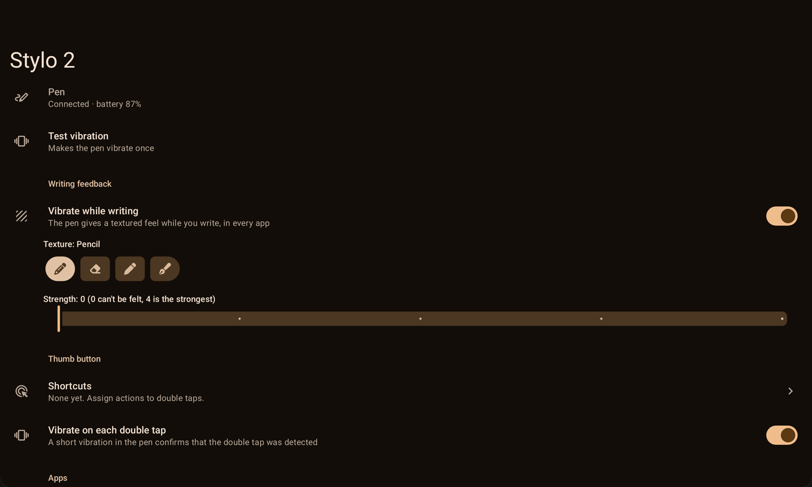
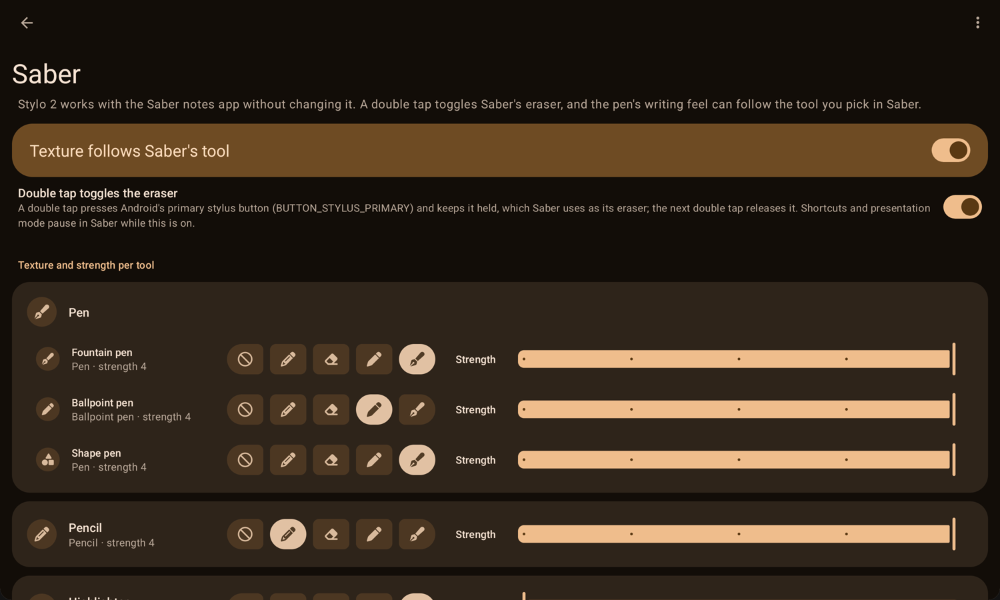
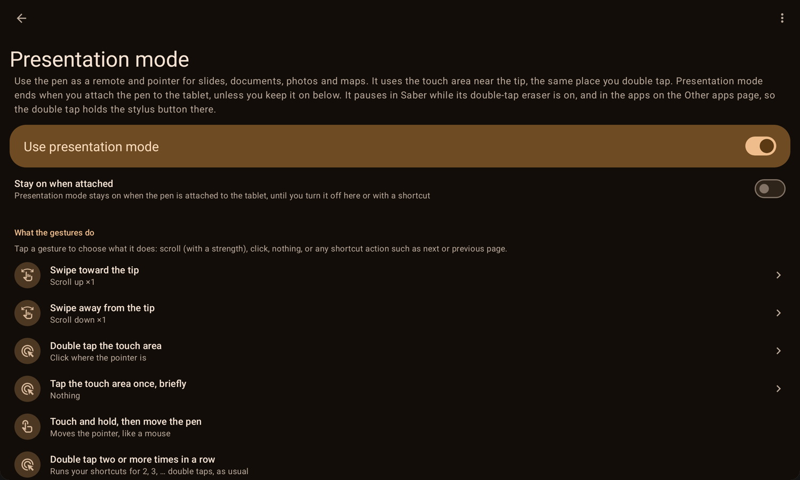
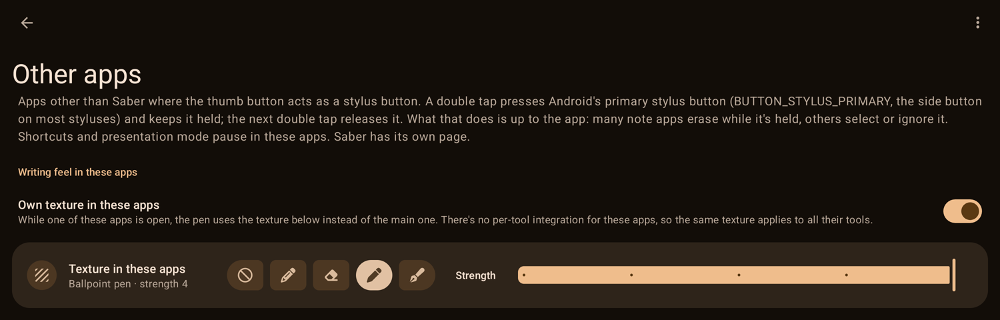

# OnePlus Stylo 2 for the OnePlus Pad 2 on AOSP ROMs

A KernelSU module (Magisk untested) with a small app that brings the OxygenOS features of the OnePlus Stylo 2, and a few more,
on AOSP-based ROMs (tested on PixelOS 17 for `caihong`). It's for the Pad 2 only: the pen pairs
through the tablet's magnetic charger and can't be found or connected to by other devices (see
[RESEARCH.md](docs/RESEARCH.md#10-other-devices)).

Features:

- **Writing feedback** ("textured vibration"): the pen vibrates while you write, in every app. Choose
  the texture (pencil, eraser, ballpoint pen, pen) and the strength.
- **Thumb-button shortcuts**: the pen reports double taps; chain them (double tap, double tap ×2, …)
  and give each its own action: open an app, media keys, a broadcast intent (Tasker and similar apps)
  or a Home Assistant webhook, next/previous page, applying a preset, and switching the app's own
  settings ("Nothing" skips a count, e.g. to use only four double taps). Attaching the pen to the
  charger and taking it off can run actions too, and every pen event can be broadcast to automation
  apps.
- **Quick Settings tiles**: presentation mode, writing feel on/off, and the pen texture. Long-press a
  tile to open its page.
- **Saber**: in [Saber](https://github.com/saber-notes/saber), a double tap toggles the eraser, and the
  texture follows the active tool, with a texture and strength per tool. Both can be turned off.
- **Other apps**: in apps you add to this list, a double tap holds or releases Android's primary
  stylus button (`BUTTON_STYLUS_PRIMARY`); what that does is up to the app. Optionally, one texture
  applies to all of them.
- **Presentation mode**: the touch area near the tip becomes a remote: touch and move the pen to move
  the pointer (air mouse), and give each gesture (swipe toward or away from the tip, single tap, double
  tap) an action: scroll with a chosen strength, click, right click (opens menus, like a long press),
  middle click, next/previous page, or any shortcut action. A live touch timeline shows how long each
  touch lasted against the tap and hold zones, and its handles set the tap timing.
- **Presets**: save all settings under a name and switch between setups from the app or with a
  shortcut ("Apply preset"). Every page can also be reset to its defaults.

It also shows the pen's battery level and whether it's on the magnetic charger, and has a live event
log for troubleshooting.

## Screenshots

| Main page | Saber |
|---|---|
|  |  |
| **Presentation mode** | **Other apps** |
|  |  |

## How it works

The app keeps a Bluetooth LE connection to the paired pen. Each time the pen connects, it sends the
writing feedback setting and subscribes to the button. See [docs/PROTOCOL.md](docs/PROTOCOL.md) for
the protocol, [docs/RESEARCH.md](docs/RESEARCH.md) for how it was worked out, and
[docs/STYLO2.md](docs/STYLO2.md) for the original research log.
No OnePlus code or apps are used.

## Install

1. Pair the pen with the tablet as usual.
2. Download the module zip from [Releases](https://github.com/ardyln/oneplus-pad2-stylo2/releases),
   install it with KernelSU and reboot. Magisk should work the same way, but it has never been
   tested.
3. Open the **Stylo 2** app to choose the texture, strength, shortcuts and notes-app options.

At boot the module:
- installs the app and grants it background activity starts (to open apps from a shortcut), usage
  access, and an exemption from battery optimization;
- enables the app's accessibility service "Stylo 2: active app", which only reads the package name of
  the focused window (to know when Saber or one of the other apps is in use, also in desktop
  windowing mode);
- starts a root helper (`stylus-bridge.sh`) that pipes the app's commands into Android's `uinput`
  tool, which creates three virtual input devices: a stylus button (for Saber and the other apps), a
  mouse (presentation clicks and scrolling) and a keyboard with Page Up/Down (page shortcuts). The
  helper also reads Saber's settings file to see its active tool, and runs `penpointer.jar` (source in
  `helper/`), which forwards the touch area's keys from the pen's HID keyboard to the app and takes
  the pen's HID mouse exclusively while presentation mode is on, so swipes can be remapped; pointer
  movement is passed on unchanged through a fourth virtual device. Both are found again after the
  pen reconnects.

Removing the module undoes all of this (tested with KernelSU: removing it, rebooting, then
installing the release zip and rebooting again leaves the system as before and sets everything up
again; the app's settings are removed with the app). KernelSU (and presumably Magisk) shows new versions from this repo's
releases as module updates.

## Saber

Saber itself is not modified. The integration works from the outside: Android merges the virtual
stylus button (`BUTTON_STYLUS_PRIMARY`) into the pen's input, which Saber uses as its eraser, and the
active tool is read from Saber's settings. Saber's developers aren't involved, so please don't report problems
with this integration to Saber.

## Build

`KS_PASS=<keystore password> tools/build.sh` builds the app with the Gradle wrapper (Kotlin, AndroidX
Preference, Material Components 1.14 with Material 3 Expressive) and packs the module zip into `build/`. It needs JDK 21 and an Android
SDK with platform 35 and build-tools 36 (`ANDROID_HOME`, default `~/Android/Sdk`). The signing key
is created on the first build at `~/tools/stylo2-release.jks` and is not part of the repo.

The settings screen follows the structure of LineageOS's device settings (a preference screen in
`res/xml`, a main switch, categories), using the public AndroidX/Material libraries in place of
SettingsLib, which is only available inside the Android source tree.

## Repository

| Path | Contents |
|---|---|
| `app/` | the Android app (Kotlin) |
| `helper/` | `penpointer.jar`, the root helper for presentation mode (Java, run with `app_process`) |
| `module/` | KernelSU/Magisk module scripts, including the root helper `stylus-bridge.sh` |
| `docs/` | `PROTOCOL.md` (the pen's BLE protocol), `RESEARCH.md` (findings), `STYLO2.md` (research log) |
| `tools/build.sh` | builds the app and the module zip |
| `tools/penprobe/` | debug app used for the research: subscribes to the pen's notifications and can send a small allowlist of stock commands |
| `tools/gatt_cache_dump.py` | decodes an Android `gatt_cache_*` file into services and characteristics |
| `tools/research/` | test scripts and the tablet's input device list |
| `update.json`, `CHANGELOG.md` | update information for KernelSU/Magisk, and the changes per version |

## License

[Apache License 2.0](LICENSE), copyright 2026 ardyln, chosen so parts can move into LineageOS or AOSP
without relicensing. Third-party icons keep their own licenses (see [NOTICE](NOTICE) and below).
Most of the code and docs were written with an AI assistant (Claude), under the author's direction
and testing on the device.

## Credits

- Tool and texture icons from [Font Awesome Free](https://fontawesome.com) 6 by Fonticons, Inc.,
  [CC BY 4.0](https://creativecommons.org/licenses/by/4.0/): the same icons
  [Saber](https://github.com/saber-notes/saber) uses for its tools.
- Other icons from [Material Symbols and Material Icons](https://fonts.google.com/icons) by Google,
  Apache-2.0.
